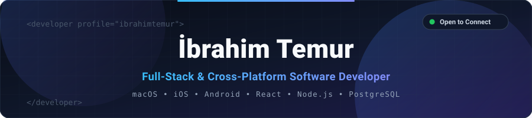

<!-- ===================================================================== -->
<!--               İBRAHİM TEMUR - GITHUB PROFİLİ (TÜRKÇE)                 -->
<!-- ===================================================================== -->

<picture>
  <source media="(prefers-color-scheme: dark)" srcset="./assets/header-dark.svg" />
  <source media="(prefers-color-scheme: light)" srcset="./assets/header-light.svg" />
  
</picture>

 

  <a href="./README.md"> English</a> &nbsp;•&nbsp;  <b>Türkçe</b>

  
  
  
  

---

### 👋 Hakkımda

Yerel masaüstü/mobil ekosistemler (**macOS, iOS, Android**) ile modern **Full-Stack web mimarileri** arasında yüksek performanslı çözümler üreten bir **Yazılım Geliştiriciyim**. Donanım seviyesinde girdi (input) yönetimi ve WebSocket üzerinden gerçek zamanlı ekran aktarımından, serverless PostgreSQL tabanlı algoritmik eşleştirme sistemlerine kadar uçtan uca ürünler geliştiriyorum.

- 🔭 **Odak Alanlarım:** Çapraz platform uygulamalar (`macOS`, `iOS`, `Android`, `Flutter`) ve ölçeklenebilir Full-Stack web sistemleri (`React 19`, `Node.js`, `PostgreSQL`).
- ⚡ **Uzmanlık:** Düşük gecikmeli ağ protokolleri (`WebSockets`, `Zeroconf/Bonjour`), Native arayüzler (`SwiftUI`, `Jetpack Compose`, `PyQt6`) ve modern web teknolojileri.
- 📫 **İletişim:** [**ibrahimtemur847@gmail.com**](mailto:ibrahimtemur847@gmail.com) • [**linkedin.com/in/ibrahim-temur**](https://www.linkedin.com/in/ibrahim-temur)

---

### 🚀 Öne Çıkan Projeler

- 🍎 **[Mac Remote](https://github.com/ibrahimtemur/mac-remote-app):** iPhone, iPad ve Android cihazları macOS için ultra düşük gecikmeli kablosuz Trackpad, Klavye ve Canlı Ekran Yansıtma kontrolcüsüne dönüştüren çapraz platform sistem.
- ☕ **[Info Session — Akıllı Masa Eşleştirme](https://info-session-psi.vercel.app/):** Topluluk etkinlikleri için 8 boyutlu vektör eşleştirme algoritması, canlı admin/projektör paneli ve Neon Postgres altyapısına sahip Full-Stack uygulama.
- 📱 **Portföy & Varlık Takip Uygulaması (`portfoy_app`):** Flutter ve Dart ile geliştirilmiş çapraz platform mobil portföy yönetim uygulaması.
